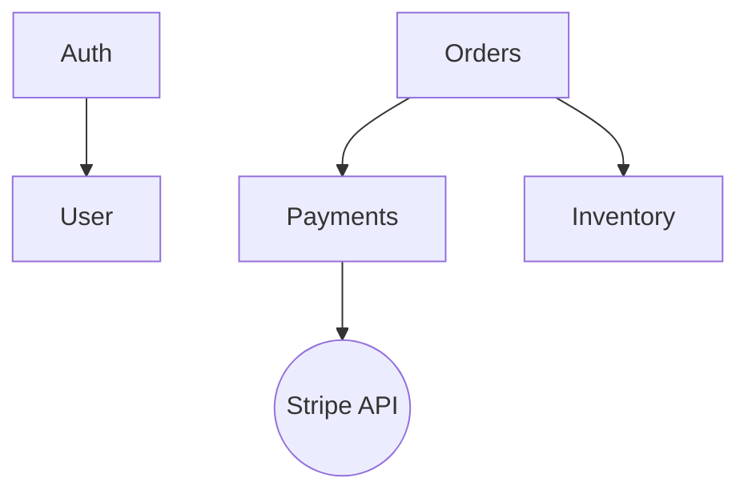

# blublu — AI Codebase Memory & Architecture Tracking System

[](CHANGELOG.md)
[](LICENSE)
[](skills/blublu/SKILL.md)
[](docs/installation.md)

> **Persistent Architectural Memory for AI Coding Agents.**  
> Never let your AI agent forget how your codebase works between sessions.

---

*Jump to: [Ringkasan Bahasa Indonesia](#-ringkasan-bahasa-indonesia) | [Documentation Index](docs/) | [Blueprint Template](skills/blublu/references/blueprint-template.md)*

---

## 📌 The Problem

Modern AI coding agents (such as Google Antigravity, Anthropic Claude Code, and OpenAI Codex) excel at localized code generation and refactoring. However, in long-lived or complex projects, they suffer from three critical bottlenecks:

1. **Context Amnesia Across Sessions**: Every new prompt or conversation starts from zero context, requiring agents to blindly guess project conventions or crawl dozens of source files repeatedly.
2. **Token Burn from Re-Scanning**: Re-reading file trees and multi-thousand-line source files on every prompt exhausts token limits and increases latency.
3. **Architectural Hallucinations**: Without an explicit architectural map, agents accidentally violate layering, create circular dependencies, or invent duplicate helper modules that already exist elsewhere.

---

## 💡 The Solution: blublu

**blublu** maintains a persistent, verified, token-efficient architectural blueprint at `.agents/codebase-map.md`. It provides:

- **Source Code Is Ground Truth**: Every tracked module and route is tied to verifiable source files on disk.
- **Hybrid Operating Mode**: Ambient automatic lifecycle (`BEFORE TASK` -> `DURING TASK` -> `AFTER TASK`) alongside explicit commands (`initialize`, `update`, `rebuild`, `validate`, `impact`, `status`).
- **Balanced Mapping Depth**: Level 1 (Topology), Level 2 (Module Boundaries & Responsibilities), and Level 3 (Critical Schemas & Data Flows) without micro-noise.
- **Git-Aware Incremental Sync**: Detects modifications via `git diff` and updates only affected sections, saving thousands of tokens per task.
- **Multi-Agent Compatibility**: Works natively with Google Antigravity, Claude Code, and OpenAI Codex via standard skill and instruction hooks.

---

## 🔄 How It Works

```
              ┌──────────────────────────────────────────────┐
              │                USER REQUEST                  │
              └──────────────────────┬───────────────────────┘
                                     │
                                     ▼
        ┌──────────────────────────────────────────────────────────┐
        │  1. READ BEFORE CODING                                   │
        │     Agent consults `.agents/codebase-map.md` to load    │
        │     topology, module boundaries, and conventions.        │
        └────────────────────────────┬─────────────────────────────┘
                                     │
                                     ▼
        ┌──────────────────────────────────────────────────────────┐
        │  2. UNDERSTAND BEFORE MODIFYING                          │
        │     Agent traces dependencies and blast radius of        │
        │     the proposed changes.                                │
        └────────────────────────────┬─────────────────────────────┘
                                     │
                                     ▼
        ┌──────────────────────────────────────────────────────────┐
        │  3. CODE & EXECUTE                                       │
        │     Implement requested feature or bugfix while         │
        │     respecting architectural layers and conventions.     │
        └────────────────────────────┬─────────────────────────────┘
                                     │
                                     ▼
        ┌──────────────────────────────────────────────────────────┐
        │  4. VERIFY AGAINST DISK                                  │
        │     Confirm new files, exported symbols, and paths.      │
        └────────────────────────────┬─────────────────────────────┘
                                     │
                                     ▼
        ┌──────────────────────────────────────────────────────────┐
        │  5. UPDATE ARCHITECTURAL MEMORY                          │
        │     If changes are architectural, incrementally update   │
        │     `.agents/codebase-map.md` and refresh health metrics.│
        └──────────────────────────────────────────────────────────┘
```

---

## 🚀 Quick Start & Installation

### Option A: Install via Shell Script (Linux & macOS)

```bash
# Install to current repository (Project Scope)
curl -fsSL https://raw.githubusercontent.com/blublu/blublu/main/install.sh | bash

# Install globally for all agent sessions (Global Scope)
curl -fsSL https://raw.githubusercontent.com/blublu/blublu/main/install.sh | bash -s -- --scope global
```

### Option B: Install via PowerShell (Windows)

```powershell
# Install to current repository (Project Scope)
iwr -useb https://raw.githubusercontent.com/blublu/blublu/main/install.ps1 | iex

# Install globally for all agent sessions (Global Scope)
& { iwr -useb https://raw.githubusercontent.com/blublu/blublu/main/install.ps1 } -Scope global
```

*For custom agents, manual skill copies, and dry-run flags, see the [Installation Guide](docs/installation.md).*

---

## 🕹️ Operating Modes & Commands Reference

In addition to running automatically in the background during coding tasks, you can invoke `blublu` directly in your prompt:

| Command / Intent | What It Does | Example Prompt |
| :--- | :--- | :--- |
| `initialize` | Scans repository and creates the initial `.agents/codebase-map.md`. | `"Run blublu initialize on this repository"` |
| `update` | Analyzes uncommitted/recent changes and syncs touched modules. | `"blublu update"` or `"Sync architectural map"` |
| `rebuild` | Performs a fresh full-repository scan and regenerates the blueprint. | `"blublu rebuild blueprint from scratch"` |
| `validate` | Audits blueprint against files on disk and self-heals discrepancies. | `"blublu validate codebase map"` |
| `impact [module]` | Traces upstream consumers, dependencies, and blast radius of a module. | `"blublu impact src/modules/auth"` |
| `status` | Reports blueprint health, tracked modules, and verification ratio. | `"blublu status"` |

*For complete usage guidelines and examples, see the [Usage Guide](docs/usage.md).*

---

## 📋 Example Blueprint Snippet

Below is a preview of the structured memory maintained in `.agents/codebase-map.md`:

````markdown
# Codebase Blueprint: E-Commerce API

## 4. Architecture Overview
- **Style**: Modular Monolith with Domain-Driven Design (DDD)
- **Layers**: Controller (HTTP) -> Service (Domain) -> Repository (Drizzle ORM)

## 5. Module Registry
| Module | Path | Responsibility | Dependencies | Status |
| :--- | :--- | :--- | :--- | :--- |
| `Auth` | `src/modules/auth` | JWT issuance & Argon2 password hashing | `User`, `Config`, `Db` | [Verified] |
| `Orders` | `src/modules/orders` | Checkout state machine & inventory lock | `Payments`, `Inventory` | [Verified] |
| `Payments`| `src/modules/payments` | Stripe checkout session orchestration | `Config`, `Db` | [Verified] |

## 6. Dependency Mapping


## 15. Mapping Health
- **Last Updated**: 2026-11-27 08:30 UTC
- **Health Status**: Healthy (Verification Ratio: 100%)
````

---

## 🌐 Language-Agnostic Architecture

blublu is completely **language-agnostic and framework-agnostic**. It operates strictly on universal software engineering concepts: filesystem topology, module boundaries, entry points, public interface contracts, and data flows.

Whether your repository is built with:
- **Systems & Backend**: Go, Rust, Python, Java/Kotlin, C#, C++, Elixir, PHP
- **Web & Mobile**: TypeScript/JavaScript, Dart (Flutter), Swift, React Native
- **Frameworks**: Spring Boot, Django, FastAPI, Next.js, Express, Laravel, Gin, Actix

blublu maps your codebase with identical fidelity. The fixtures included in `tests/fixtures/` (`simple-node-app`, `laravel-app`, and `react-app`) serve as architectural paradigm demonstrators (Layered Monolith, Server-Side MVC, and Client-Side SPA), not language constraints.

---

## ⚠️ Known Limitations (v1.0)

While blublu v1.0 provides production-ready codebase memory, users and agent operators should be aware of the following technical boundaries:

1. **Massive Monorepos (> 50 Modules)**:
   - *Limitation*: In very large monorepos or enterprise microservice suites with more than 50 independent services/packages, recording every module in a single `.agents/codebase-map.md` can approach ~3,500 tokens, which reduces context budget for active coding.
   - *Interim Mitigation*: Restrict Section 5 (Module Registry) to high-level domain boundaries (e.g., mapping `apps/billing` rather than every internal subfolder), or create localized blueprints per service. Native multi-blueprint delegation is planned for v1.2.0.
2. **Git CLI Dependency & Fallback Latency**:
   - *Limitation*: The high-speed incremental diff engine leverages native Git commands (`git status --short`, `git diff --stat`).
   - *Interim Mitigation*: In non-git environments (or environments where Git is inaccessible), blublu automatically falls back to filesystem timestamp scanning. While fully functional, filesystem walking incurs higher latency than native Git indexing.
3. **Dynamic Mermaid Diagram Synthesis**:
   - *Limitation*: Section 6 (Dependency Mapping) uses Mermaid flowchart syntax (`graph TD`). While cutting-edge frontier models handle Mermaid reliably, smaller or older LLMs with limited spatial/syntax reasoning may occasionally produce malformed arrows or invalid node labels when splicing in new modules.
   - *Interim Mitigation*: blublu includes strict Mermaid node quoting and connection guidelines in `mapping-rules.md` to prevent syntax corruption.

---

## 📂 Repository Structure

```
blublu/
├── skills/
│   └── blublu/
│       ├── SKILL.md                          # Open Standard Agent Skill definition
│       └── references/
│           ├── blueprint-template.md         # 15-section canonical map template
│           ├── mapping-rules.md              # Depth guidelines & ignore filters
│           ├── update-rules.md               # Git-aware incremental diff rules
│           └── validation-rules.md           # Integrity audit & self-healing rules
├── docs/
│   ├── architecture.md                       # Technical whitepaper & design philosophy
│   ├── installation.md                       # Cross-platform installation & configuration
│   └── usage.md                              # Daily workflows, commands & troubleshooting
├── CHANGELOG.md                              # Version history (Keep a Changelog)
├── CONTRIBUTING.md                           # Open-source contribution guidelines
├── LICENSE                                   # MIT License
└── README.md                                 # Project documentation root
```

---

## 🇮🇩 Ringkasan Bahasa Indonesia

**blublu** adalah sistem pelacak memori arsitektur berbasis standar keagenan terbuka (Open Agent Skills) untuk AI coding agents seperti Google Antigravity, Claude Code, dan OpenAI Codex.

### Mengapa blublu Dibutuhkan?
- **Mencegah Hilang Konteks**: AI agent sering lupa struktur arsitektur pada percakapan/sesi baru, menyebabkan regenerasi kode yang melanggar arsitektur.
- **Hemat Token & Waktu**: Menghilangkan kebutuhan bagi AI untuk memindai ulang seluruh direktori dan ribuan baris kode di setiap tugas.
- **Verifikasi Real-Time**: Informasi arsitektur pada berkas `.agents/codebase-map.md` selalu diverifikasi langsung terhadap kode sumber nyata di disk.

### Fitur Utama:
1. **Mode Hibrida**: Bekerja secara otomatis di latar belakang (*Before Task*, *During Task*, *After Task*) atau melalui perintah manual (*initialize*, *update*, *rebuild*, *validate*, *impact*, *status*).
2. **Pemetaan Seimbang (Balanced Mapping)**: Dokumentasi fokus pada level 1 (topologi), level 2 (batasan modul), dan level 3 (alur data kritis) tanpa mencatat detail mikro yang membuang token.
3. **Language-Agnostic Penuh**: Bekerja netral pada semua bahasa pemrograman (Go, Rust, Python, PHP, Java/Kotlin, C#, TypeScript, Dart, dll.). Fixture yang disediakan hanyalah sampel paradigma arsitektur.
4. **Sinkronisasi Cerdas Berbasis Git**: Mendeteksi perubahan secara presisi menggunakan `git diff` dan hanya memperbarui modul yang terdampak.
5. **Dukungan Multi-Agent**: Kompatibel langsung dengan Google Antigravity, Claude Code, dan OpenAI Codex.

### Keterbatasan Diketahui (v1.0):
- **Monorepo Skala Raksasa (> 50 Modul)**: Membutuhkan pengelompokan modul tingkat tinggi agar tidak mendekati batas ~3.500 token (arsitektur sub-blueprint multi-file dijadwalkan untuk v1.2.0).
- **Fallback Non-Git**: Pemindaian tanpa CLI Git menggunakan timestamp filesystem dengan latensi sedikit lebih tinggi.
- **Sintaks Mermaid**: Pembaruan diagram dependensi otomatis memerlukan kepatuhan ketat terhadap aturan quoting label agar tidak dirusak oleh model LLM kecil.

---

## 🗺️ Roadmap

- [x] **v1.0.0**: Core Skill, 15-Section Blueprint Template, Mapping Rules, Update Engine, Cross-platform Installers (`install.sh`, `install.ps1`), Headless Python Validator, Fixtures & Test Scenarios.
- [x] **v1.1.0**: Advanced Filesystem Fallback Scanner (`scripts/scanner.py`), Automated Mermaid Syntax Validator & Table Fallback, Staleness/Drift Detection (`--check-staleness`), Official GitHub Actions CI Workflows (`.github/workflows/`).
- [ ] **v1.2.0**: Multi-Blueprint Monorepo Support (`.agents/sub-blueprints/`) & Architecture Drift Badge Generator.
- [ ] **v1.3.0**: Interactive CLI visualizer and webview sidecar integration.
- [ ] **v2.0.0**: Autonomous Architectural Evolution with LSP call-graph synthesis and swarm arbitration.

*See full details in [Roadmap Documentation](docs/roadmap.md).*

---

## 🤝 Contributing & License

Contributions are welcome! Please read [CONTRIBUTING.md](CONTRIBUTING.md) for guidelines on submitting pull requests and reporting issues.

Distributed under the **MIT License**. See [LICENSE](LICENSE) for details.
