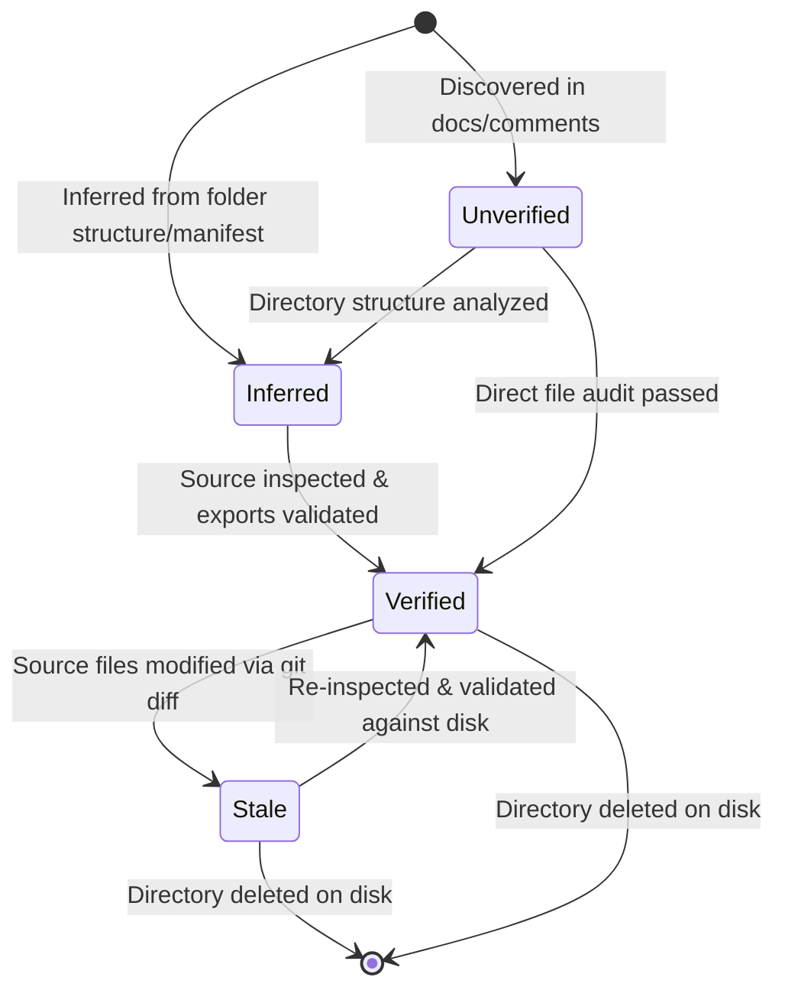
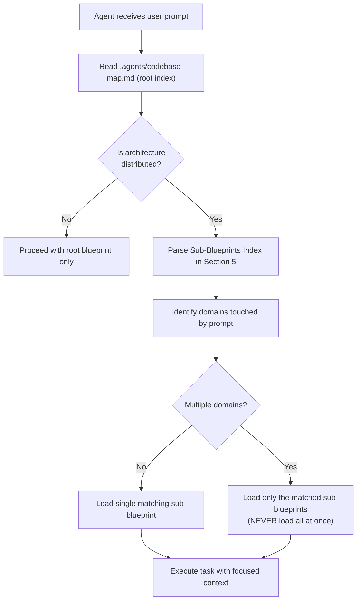

# Technical Architecture: blublu

This document provides a deep dive into the engineering principles, architectural memory models, state machines, and diff synchronization mechanics underpinning **blublu**.

---

## 1. Design Philosophy

blublu was conceived to bridge the gap between volatile agent context windows and persistent software architectures. It adheres to three foundational tenets:

### A. Source Code Is the Ground Truth
Documentation frequently rots when divorced from code. In blublu:
- No architectural assertion exists in `.agents/codebase-map.md` without corresponding files, functions, or configurations on disk.
- If code and blueprint disagree, the agent treats the code as truth and patches the blueprint.
- Guesses or speculative plans are strictly segregated via verification statuses until confirmed.

### B. Token Efficiency & Cognitive Signal
Context windows are expensive and bounded. blublu treats tokens as a finite budget:
- Every section is formatted in high-density, parse-friendly Markdown (tables, concise bullet points, directed Mermaid graphs).
- Micro-implementation details (private methods, local variables, styling rules) are filtered out.
- The blueprint is structured so an agent can quickly ingest high-level architecture in under 1,500 tokens.

### C. Non-Destructive Operation
Operating as an autonomous agent layer requires stringent safety boundaries:
- blublu never performs destructive version control actions (e.g. `git reset --hard`, `git clean -fd`, `git restore .`).
- All architectural state is contained entirely in `.agents/codebase-map.md`, preventing clutter across source folders.
- Credentials, private tokens, and environment secrets are strictly redacted.

---

## 2. The Three-Tier Architectural Memory Model

blublu models codebase memory across three hierarchical layers of abstraction:

```
┌────────────────────────────────────────────────────────┐
│ Level 1: Structural Topology                           │
│  - Runtime environment & platform                      │
│  - Application entry points & bootstrap files          │
│  - High-level directory tree (depth: 2-3 levels)       │
├────────────────────────────────────────────────────────┤
│ Level 2: Component Boundaries & Intersystem Relations  │
│  - Module Registry (paths, contracts, responsibilities)│
│  - Directed dependency flow graph (Mermaid)            │
│  - Cross-cutting concerns & architectural style        │
├────────────────────────────────────────────────────────┤
│ Level 3: Domain Knowledge & Invariants                 │
│  - Critical data flows (end-to-end execution paths)    │
│  - Database entities & external service integrations   │
│  - Non-negotiable business rules & technical debt log  │
└────────────────────────────────────────────────────────┘
```

### Layer Details:
1. **Level 1 (Structural Topology)**: Enables the agent to immediately orient itself within the operating environment, identify how the program boots, and locate major directories without recursive filesystem scans.
2. **Level 2 (Boundaries & Relations)**: Protects against architectural erosion. When asked to add a feature, the agent consults this layer to determine which module owns the capability and which existing components it is permitted to import.
3. **Level 3 (Domain Knowledge & Invariants)**: Captures business semantics that cannot be deduced from syntax alone (e.g., token expiration lengths, soft-deletion requirements, payment webhook idempotency).

---

## 3. Verification State Machine

To prevent misinformation from persisting, every module tracked in Section 5 (Module Registry) undergoes continuous verification lifecycle tracking:



### State Semantics:
- `[Unverified]`: Found in legacy documentation, comments, or hypothesized by directory naming, but not yet corroborated by opening source files.
- `[Inferred]`: Deduced from standard convention (e.g., a folder named `src/routes/` in an Express app) without deep inspection of its internal exports.
- `[Verified]`: Confirmed directly by reading source code files on disk. Exports, paths, and dependencies have been validated.
- `[Stale]`: Previously verified, but git status or file modification timestamps indicate the files were altered without synchronization.

---

## 4. Git-Aware Diff Engine & Fallback Synchronization

### A. Git-Aware Incremental Engine
Rather than recursively walking the entire project tree on every task, blublu utilizes the local Git index to detect changes in milliseconds:

```
[Agent Completes Code Task]
            │
            ▼
┌─────────────────────────┐
│   `git status --short`  │ ──> Detects untracked (??), modified (M),
│   `git diff --stat`     │     added (A), deleted (D), renamed (R) files
└───────────┬─────────────┘
            │
            ▼
┌─────────────────────────────────────────────────────────┐
│ Evaluate against Change Trigger Matrix:                 │
│ • Did module contracts, public exports, or paths change?│
│ • Were database schemas or API routes altered?          │
│ • Were dependencies added or removed?                   │
└───────────┬─────────────────────────────────────────────┘
            │
      ┌─────┴─────────────────────────┐
      ▼                               ▼
[Architectural Changes]     [Internal Implementation]
• Update affected tables     • No blueprint change required
• Append to Section 14       • Conclude task immediately
• Refresh Section 15
```

### B. Fallback Mode (Non-Git Environments)
When running in environments where Git is not initialized or the `git` binary is inaccessible (e.g. sandboxed containers, isolated archives):
1. **Path Delta Auditing**: The agent inspects the specific directories listed in the blueprint's `Module Registry` and checks whether file existence matches.
2. **Timestamp Verification**: Compares filesystem modified timestamps against the `Last Updated` metadata in Section 15.
3. **Integrity Validation**: Runs the checklist defined in `validation-rules.md` to flag unmapped directories and pruned files.

---

## 5. Language-Agnostic Design Principles

blublu was deliberately architected without coupling to any specific programming language, compiler toolchain, or framework ecosystem. Its memory model abstracts software repositories using universal computer science constructs:

1. **Topological Invariance**: Regardless of whether a project is written in Go, Rust, Python, PHP, C#, Java, TypeScript, or Dart, all production codebases organize code into entry points, module boundaries, directory trees, and external integrations.
2. **Standard Manifest Agnosticism**: blublu identifies dependencies and configurations by inspecting root manifests (`package.json`, `Cargo.toml`, `go.mod`, `composer.json`, `pyproject.toml`, `pom.xml`, `build.gradle`, etc.) rather than parsing language-specific ASTs.
3. **Demonstrator Fixtures vs. Language Scope**: The fixtures supplied in `tests/fixtures/` (`simple-node-app`, `laravel-app`, and `react-app`) serve as concrete demonstrations of distinct **architectural paradigms**:
   - `simple-node-app`: Minimalist Layered REST API (Controller -> Service -> Data).
   - `laravel-app`: Enterprise Server-Side MVC (Router -> Controller -> Eloquent Model -> Database Migrations).
   - `react-app`: Client-Side Single Page Application (DOM Mount -> View Shell -> Presentational Components -> Stateful Hooks).

An AI agent using blublu can map an idiomatic Go microservice, a high-performance Rust CLI, or a Spring Boot enterprise service using the exact same 15-section blueprint schema.

---

## 6. Known Technical Limitations & Mitigations (v1.0)

As of version 1.0.0, the blublu architecture operates within three recognized constraints:

### A. Monorepos with > 50 Modules (Token Budget Pressure)
- **Constraint**: In very large enterprise monorepos (e.g. 50+ microservices or independent shared libraries), recording every discrete module in a single `.agents/codebase-map.md` table can generate 3,000–4,000 tokens of documentation, consuming context budget before task execution begins.
- **Mitigation in v1.0**: Agents are instructed to group modules at the domain boundary level (e.g. `services/billing` as a single unit rather than decomposing its 12 subdirectories).
- **Planned Resolution (v1.2.0)**: Implementation of a hierarchical multi-blueprint architecture (`.agents/sub-blueprints/`) where a root map points to isolated module maps loaded on demand.

### B. Fallback Scanning Latency in Non-Git Environments
- **Constraint**: The incremental update engine relies on Git index diffing (`git status --short`, `git diff --stat`) for sub-second change detection. In non-git environments, blublu must crawl directory trees and inspect filesystem modification timestamps.
- **Mitigation in v1.0**: Scans are bounded by strict ignore rules (excluding `node_modules`, `vendor`, `target`, `.cache`, build outputs) to minimize I/O overhead.

### C. Mermaid Diagram AST Handling by Variable-Capacity LLMs
- **Constraint**: Section 6 structures dependency topologies via Mermaid (`graph TD`). While frontier models (Claude 3.5 Sonnet, Gemini 1.5 Pro, GPT-4o) reliably manipulate Mermaid graphs, smaller or distilled models with limited visual reasoning can produce syntax errors (such as unquoted node brackets or broken arrow syntax).
- **Mitigation in v1.0**: blublu enforces strict Mermaid node quoting and connection guidelines in `mapping-rules.md`.

---

## 7. Distributed Blueprint Architecture (v1.2.0)

Version 1.2.0 introduces a hierarchical multi-file blueprint system for large-scale projects to solve the monorepo token-budget problem described in Section 6A.

### A. Architecture Overview

```
.agents/
├── codebase-map.md              ← Root Index Blueprint (always read first)
│   └── Section 5 contains:     ← Module Registry + Sub-Blueprints Index table
│       ├── [primary modules]    ← Modules owned directly by root
│       └── Sub-Blueprints Index ← Maps domains → sub-blueprint paths
│
└── sub-blueprints/
    ├── api.md                   ← Domain Blueprint: API service
    ├── web.md                   ← Domain Blueprint: Web frontend
    └── auth.md                  ← Domain Blueprint: Auth & Identity
```

Each sub-blueprint uses a 7-section schema (derived from the root 15-section schema):
1. Domain Identity & Scope
2. Entry Points & Bootstrap
3. Module Registry (domain-scoped)
4. Dependency Mapping (domain-scoped Mermaid)
5. API Contracts / Public Interface
6. Data Flows & Integrations
7. Recent Changes & Health

### B. Context-Aware Loading Protocol

The progressive loading rule is **mandatory** and must be followed by every agent consuming a distributed blueprint:



**Core constraint**: An agent **must never** pre-load all sub-blueprints speculatively. This would negate the token savings that distributed mode provides.

### C. Orphaned Sub-Blueprint Detection

The validator (`scripts/validate-blueprint.py`) enforces referential integrity in distributed mode:
- **Registered but missing**: A path listed in the Sub-Blueprints Index that has no corresponding `.md` file on disk → `[ERR]` exit code 1.
- **Orphaned file**: A `.md` file present in `.agents/sub-blueprints/` that is not registered in the root index → `[ERR]` exit code 1.
- **Valid state**: Every registered domain has a matching file; every file in the directory is registered.

### D. Single-File Backward Compatibility

Distributed mode is strictly **opt-in**. Projects using v1.0 or v1.1 single-file blueprints require no migration and continue to function identically. The validator automatically detects the architecture mode from the root blueprint's Section 5 structure.

| Project Type | Root Blueprint | Sub-Blueprints Dir | Mode Auto-Detected |
|---|---|---|---|
| Legacy / Small | `.agents/codebase-map.md` | Not present | Single-File |
| Large / Distributed | `.agents/codebase-map.md` + Sub-Blueprints Index | `.agents/sub-blueprints/*.md` | Distributed |

---

## 8. Unified CLI Architecture (v1.2.0)

### A. Component Map

```
scripts/
├── blublu.py      ← Core Python engine (init, status, validate, migrate, watch, stop)
├── watcher.py      ← Standalone background watcher daemon (debounce, PID, event queue)
├── scanner.py      ← Git/filesystem dual-mode change detector (from v1.1.0)
├── validate-blueprint.py  ← Standalone validator (from v1.0.0, updated in v1.2.0)
│
├── blublu         ← POSIX shell launcher (Linux/macOS)
├── blublu.ps1     ← PowerShell launcher (Windows)
└── blublu.cmd     ← CMD launcher (Windows legacy)
```

### B. Watcher Internals

The watcher (`scripts/watcher.py`) operates as a background daemon:
- Spawned via `blublu watch`; PID written to `.agents/.blublu.pid`.
- Polls the project directory on a configurable interval (default: 3 seconds).
- Uses debouncing (default: 500ms) to avoid flooding on rapid saves.
- Writes accumulated events to `.agents/.pending-changes.json` atomically.
- Terminated gracefully via `blublu stop` (SIGTERM on POSIX, `taskkill` on Windows).
- Respects the same ignore list as `scanner.py`: `node_modules/`, `vendor/`, `.git/`, `dist/`, `build/`, `coverage/`, `.next/`, `.cache/`, `__pycache__/`.

