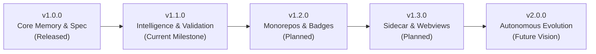

# Codsblu (blublu) Product Roadmap

This document outlines the strategic engineering roadmap for **Codsblu (blublu) — AI Codebase Memory & Architecture Tracking System** across major release milestones.

---

## Milestone Overview

---

## Milestone Breakdown

### ✔ v1.0.0 — Core Memory & Open Standard Specification (Released)
*Foundational release establishing persistent architectural memory for AI coding agents.*
- **Core Agent Skill**: Agent Skills Open Standard definition (`skills/blublu/SKILL.md`) with 7 Core Principles.
- **Canonical Blueprint Template**: 15-section structured memory schema (`.agents/codebase-map.md`).
- **Balanced Mapping Rules**: 3-level depth control filtering micro-noise.
- **Git-Aware Incremental Diff**: Surgical updates based on Git file deltas.
- **Cross-Platform Installers**: Zero-dependency `scripts/install.sh` (Bash) and `scripts/install.ps1` (PowerShell).
- **Headless Validator CLI**: Pure Python 3 structural validation script (`scripts/validate-blueprint.py`).
- **Multi-Agent Verification**: Validated compatibility with Google Antigravity, Anthropic Claude Code, and OpenAI Codex.

---

### 🚀 v1.1.0 — Intelligence, Fallback Scanner & CI/CD (Current Milestone)
*Enhancing robustness, automated syntax validation, and CI/CD gatekeeping.*
- **Advanced Filesystem Fallback Scanner (`scripts/scanner.py`)**:
  - Dual-mode change detector: auto-detects Git repository status.
  - Native Git integration (`git status --short`, `git diff --name-only`) when available.
  - Robust non-git filesystem scanner with metadata/mtime/hash caching (`.agents/.cache_scan.json`) for environments without Git.
  - Strict exclusion of `node_modules`, `vendor`, `.git`, `dist`, `build`, `coverage`, `.cache`, and loop-free symlink handling (`follow_symlinks=False`).
- **Automated Mermaid Diagram Validator**:
  - AST-style token and syntax validator inside `scripts/validate-blueprint.py`.
  - Detects unclosed brackets (`[]`, `()`), malformed arrow operators, and illegal unquoted strings.
  - Line-specific error reporting.
  - **Graceful Table Fallback**: Generates Markdown relation tables (`| Source Module | Target Module | Relationship |`) if Mermaid is malformed.
- **Staleness & Architecture Drift Detection (`--check-staleness`)**:
  - Cross-references modified file lists with registered module paths.
  - Flags outdated modules as `[STALE / NEEDS REVIEW]` when files change without blueprint updates.
- **Official GitHub Actions Workflows**:
  - `.github/workflows/codsblu-validate.yml`: Pull request and push validation gate.
  - `.github/workflows/codsblu-architecture-check.yml`: Detects code changes without blueprint updates and emits warning annotations.

---

### 📋 v1.2.0 — Monorepo Multi-Blueprint & Badge Generator (Planned)
*Scaling to large enterprise codebases and public repository visibility.*
- **Hierarchical Sub-Blueprints (`.agents/sub-blueprints/`)**:
  - Root blueprint delegates to package-specific blueprints for monorepos with > 50 packages.
  - Dynamic module index loading per active agent context.
- **Architecture Health Badge Generator**:
  - Generates SVG status badges for repository READMEs (e.g., `Architecture: 100% Verified`, `Health: Healthy`).
- **Pre-commit Hooks**:
  - Native pre-commit hook integration to block commits if architectural changes are unmapped.

---

### 📋 v1.3.0 — Interactive Sidecar & Webview Visualizer (Planned)
*Rich visual interfaces and interactive side pane integrations.*
- **Antigravity & IDE Sidecar Panels**:
  - Interactive Mol* and SVG/HTML architecture visualizers in IDE side panes.
  - Real-time click-to-navigate between diagram nodes and source files.
- **Interactive TUI CLI**:
  - Terminal user interface to browse module registries and run blast radius audits interactively.

---

### 🔮 v2.0.0 — Autonomous Architectural Evolution (Future Vision)
*Self-synthesizing architectural memory and predictive refactoring.*
- **Semantic Code Graph Engine**:
  - Language server protocol (LSP) integration for AST-level call-graph mapping.
- **Multi-Agent Swarm Architectural Arbitration**:
  - Automated merge-conflict resolution for architectural blueprints across concurrent agent swarms.
- **Automated Refactoring Impact Simulator**:
  - Predicts cross-boundary breakage before writing code.
