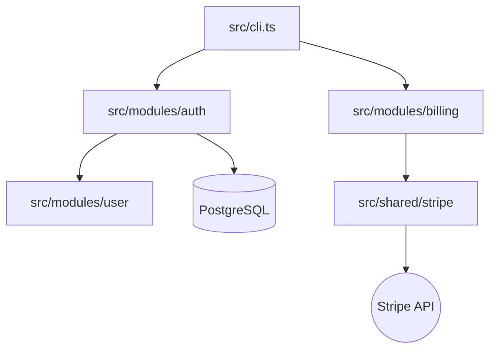

# Blueprint Template: `.agents/codebase-map.md`

This document defines the canonical structure for `.agents/codebase-map.md`. When initializing or rebuilding the codebase map, follow this exact 15-section layout.

> **Tailoring & Irrelevant Sections**:
> If a section does not apply to the current project (for example, **Section 8: API Mapping** in a CLI tool or desktop library, or **Section 9: Database Mapping** in a stateless frontend), you may either mark the section as `*N/A — Not applicable to this project*` or omit the section heading entirely. Keep sections that capture the project's actual architecture.

---

```markdown
# Codebase Blueprint: [Project Name]

> Auto-generated and maintained by **blublu**. Source code is the ultimate truth.
> Last verified against source commit: [commit-hash-or-uncommitted]

---

## 1. Project Overview

- **Name**: [e.g. blublu-engine]
- **Core Purpose**: [Concise 1-2 sentence description of what the system does]
- **Primary Tech Stack**: [Language, Primary Framework, Runtime, Key Libraries]
- **Target Platform**: [e.g. Node.js LTS (v20+), Browser, Linux CLI, Docker Container]
- **Repository Pattern**: [e.g. Monorepo, Polyrepo, Modular Monolith]

---

## 2. Entry Points

List the bootstrap files and initialization entry points into the system.

| Entry Point | File Path | Type | Purpose / Trigger |
| :--- | :--- | :--- | :--- |
| Main CLI | `src/cli.ts` | CLI / Binary | Parses command-line flags and dispatches commands |
| Web Server | `src/server.ts` | HTTP Server | Bootstraps Express/Fastify listener on port `PORT` |
| Worker / Job | `src/workers/queue.ts` | Background Process | Connects to Redis queue and listens for background jobs |

---

## 3. Directory Structure

High-level annotated directory tree (limit depth to 2–3 levels; omit generated/ignored directories).

```
project-root/
├── src/
│   ├── config/            # Environment and runtime configurations
│   ├── modules/           # Domain feature slices / business modules
│   │   ├── auth/          # Authentication & token verification
│   │   └── billing/       # Invoicing and payment processing
│   ├── shared/            # Shared cross-cutting utilities and types
│   │   ├── db/            # Database connection & shared clients
│   │   └── errors/        # Standard application error definitions
│   └── index.ts           # Root application bootstrap
├── tests/                 # Unit and integration test suites
└── package.json           # Manifest and dependency definitions
```

---

## 4. Architecture Overview

- **Architectural Style**: [e.g., Clean Architecture, Modular Monolith, Hexagonal / Ports & Adapters, MVC, Event-Driven]
- **Layering & Separation of Concerns**:
  - **Presentation Layer**: [e.g. HTTP Controllers, CLI command handlers, React views]
  - **Domain / Business Layer**: [e.g. Service classes, pure domain models, business policies]
  - **Data / Infrastructure Layer**: [e.g. Database repositories, external API clients, message brokers]
- **Cross-Cutting Concerns**: [e.g. Structured logging via Pino, centralized error handling via AppError, correlation IDs]

---

## 5. Module Registry

Comprehensive registry of all first-party modules and major components.

| Module | Path | Responsibility | Dependencies | Status |
| :--- | :--- | :--- | :--- | :--- |
| `Auth` | `src/modules/auth` | JWT issuance, password hashing, session validation | `User`, `Config`, `Shared/Db` | [Verified] |
| `User` | `src/modules/user` | User profiles, account lifecycle management | `Shared/Db`, `Shared/Errors` | [Verified] |
| `Billing` | `src/modules/billing` | Stripe customer synchronization & invoice handling | `Config`, `Shared/Http` | [Inferred] |
| `Storage` | `src/shared/storage` | S3 object uploads and presigned URL generation | `Config` | [Verified] |

*Status tags: `[Verified]`, `[Inferred]`, `[Unverified]`, `[Stale]`*

---

## 6. Dependency Mapping

Internal and key external dependency flow graph.



- **Dependency Rules**:
  - `modules/*` may import from `shared/*`, but `shared/*` MUST NEVER import from `modules/*`.
  - Modules should communicate via exported public interfaces in their module root `index.ts`.

---

## 7. Main Data Flows

Key end-to-end execution paths illustrating how requests or data move through the system.

### Flow 1: [e.g. User Authentication & Token Issuance]
1. Client sends `POST /api/auth/login` with credentials.
2. `src/modules/auth/controller.ts` validates payload schema using Zod.
3. `src/modules/auth/service.ts` calls `src/modules/user/service.ts` to locate user by email.
4. Passwords compared via `argon2`.
5. On success, signed JWT returned with 15-minute expiration; refresh token saved to Redis.

### Flow 2: [e.g. Asynchronous Report Generation]
1. `POST /api/reports` creates job record in `reports` table with status `pending`.
2. Job ID pushed to BullMQ queue `report-jobs`.
3. Worker picks up job, runs aggregations, streams CSV to S3.
4. Worker updates status to `completed` and stores S3 presigned URL.

---

## 8. API Mapping

*(Mark as N/A if not an API or service application)*

| Method | Route / Endpoint | Module | Auth Required | Description |
| :--- | :--- | :--- | :--- | :--- |
| `POST` | `/api/auth/login` | `Auth` | No | Authenticates user credentials and returns tokens |
| `GET` | `/api/user/profile` | `User` | Bearer JWT | Retrieves authenticated profile data |
| `POST` | `/api/billing/webhook`| `Billing` | Stripe Signature | Webhook handler for external charge events |

---

## 9. Database Mapping

*(Mark as N/A if stateless or no persistent database)*

- **Database Engine**: [e.g. PostgreSQL 16, SQLite, MongoDB]
- **ORM / Query Builder**: [e.g. Prisma, Drizzle, TypeORM, raw SQL]
- **Migration System**: [e.g. Drizzle Kit, Prisma Migrate, Flyway]
- **Core Entities & Tables**:
  - `users`: Core identity table (id, email, password_hash, created_at).
  - `sessions`: Active refresh sessions (id, user_id, refresh_token_hash, expires_at).
  - `invoices`: Payment records linked to `users.id` and Stripe transaction IDs.

---

## 10. External Integrations

Third-party APIs, SaaS platforms, or external protocol integrations.

| Service / Client | Integration Point | Credentials / Env Var | Purpose |
| :--- | :--- | :--- | :--- |
| Stripe | `src/shared/stripe/client.ts` | `STRIPE_SECRET_KEY` | Subscription management & checkout |
| Resend | `src/shared/mailer.ts` | `RESEND_API_KEY` | Transactional email notifications |
| AWS S3 | `src/shared/storage/s3.ts` | `AWS_ACCESS_KEY_ID`, `AWS_SECRET_ACCESS_KEY` | File attachment hosting |

---

## 11. Project Conventions

Enforced architectural and coding conventions.

- **File Naming**: `kebab-case.ts` for files, `PascalCase.tsx` for React components.
- **Error Handling**: Throw subclasses of `AppError` (`NotFoundError`, `UnauthorizedError`). Never throw raw strings.
- **Configuration Access**: Access environment variables exclusively through `src/config/index.ts`, never raw `process.env`.
- **Testing Standard**: Colocate unit tests as `[file].test.ts`. Integration tests in `tests/integration/`.

---

## 12. Important Business Rules

Core domain logic constraints and operational invariants.

- **Rule 1**: Free tier accounts cannot exceed 3 active projects.
- **Rule 2**: Invoices must be retained for at least 7 years; deletion is soft-delete only (`deleted_at` timestamp).
- **Rule 3**: Password resets expire in exactly 30 minutes and are single-use.

---

## 13. Known Limitations & Technical Debt

- [ ] Rate limiting is currently in-memory; needs migration to Redis before horizontal scaling.
- [ ] Circular dependency between `User` and `Workspace` resolved temporarily via lazy imports; needs event refactor.
- [ ] Test coverage for `src/modules/billing` is under 40%.

---

## 14. Recent Architectural Changes

Log of notable structural modifications (keep the last 5–10 entries).

- **2026-11-20**: Migrated database layer from Prisma to Drizzle ORM (`src/shared/db`).
- **2026-11-15**: Extracted `Auth` module into independent domain slice from legacy `src/controllers/auth.ts`.
- **2026-11-02**: Added BullMQ worker subsystem for background exports (`src/workers/`).

---

## 15. Mapping Health

- **Last Updated**: [YYYY-MM-DD HH:MM UTC]
- **Agent / Tool**: [e.g. blublu v1.0.0 (Antigravity)]
- **Health Status**: [Healthy | Drift Detected | Needs Rebuild]
- **Total Tracked Modules**: [Count]
- **Verification Ratio**: [Percentage of modules verified against source, e.g. 95% (19/20)]
```
