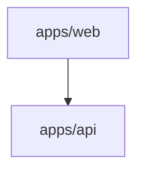

# Codebase Blueprint: Distributed Multi-Domain System

> Auto-generated and maintained by **Codsblu (blublu)**. Source code is the ultimate truth.

---

## 1. Project Overview

- **Name**: distributed-app
- **Core Purpose**: Multi-domain monorepo demonstrating Codsblu v1.2.0 distributed sub-blueprints.
- **Primary Tech Stack**: Node.js, Express, HTML5.
- **Target Platform**: Node.js & Evergreen Browsers.
- **Repository Pattern**: Distributed Monorepo

---

## 2. Entry Points

| Entry Point | File Path | Type | Purpose / Trigger |
| :--- | :--- | :--- | :--- |
| API Server | `apps/api/server.js` | Express Server | REST service listener |
| Web Portal | `apps/web/index.html` | Static HTML | Client interface entry |

---

## 3. Directory Structure

```
distributed-app/
├── apps/
│   ├── api/               # Backend REST domain
│   └── web/               # Frontend client domain
└── package.json           # Monorepo workspaces manifest
```

---

## 4. Architecture Overview

- **Architectural Style**: Distributed Multi-Domain Monorepo
- **Progressive Context Loading**: Granular module details are stored in `.agents/sub-blueprints/`. Agents load domain blueprints on demand.

---

## 5. Module Registry

| Module | Path | Responsibility | Dependencies | Status |
| :--- | :--- | :--- | :--- | :--- |
| `ApiDomain` | `apps/api` | Backend microservices and API gateways | None | [Verified] |
| `WebDomain` | `apps/web` | Frontend portal views and client assets | `ApiDomain` | [Verified] |

### Sub-Blueprints Index (Distributed Mode)

| Domain / Service | Sub-Blueprint Path | Scope / Root Path | Status |
| :--- | :--- | :--- | :--- |
| `API` | `.agents/sub-blueprints/api.md` | `apps/api` | [Verified] |
| `Web` | `.agents/sub-blueprints/web.md` | `apps/web` | [Verified] |

---

## 6. Dependency Mapping



---

## 7. Main Data Flows

### Flow 1: Client API Request
1. Browser loads `apps/web/index.html`.
2. Client queries `GET /api/health` on `apps/api/server.js`.
3. Server returns JSON `{ status: "healthy" }`.

---

## 8. API Mapping

| Method | Route / Endpoint | Module | Auth Required | Description |
| :--- | :--- | :--- | :--- | :--- |
| `GET` | `/api/health` | `ApiDomain` | No | Service status health check |

---

## 9. Database Mapping

*N/A — Handled in domain sub-blueprints.*

---

## 10. External Integrations

*N/A*

---

## 11. Project Conventions

- Monorepo package naming convention: `apps/*`.

---

## 12. Important Business Rules

- **Rule 1**: Web domain must never directly access API database models.

---

## 13. Known Limitations & Technical Debt

- Distributed mode test fixture.

---

## 14. Recent Architectural Changes

- **2026-11-27**: Bootstrapped distributed multi-domain test fixture.

---

## 15. Mapping Health

- **Last Updated**: 2026-11-27 09:20 UTC
- **Agent / Tool**: Codsblu v1.2.0
- **Health Status**: Healthy
- **Total Tracked Modules**: 2
- **Verification Ratio**: 100%
