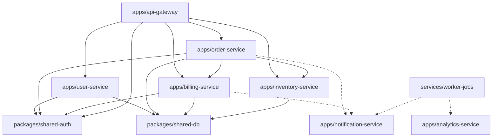

# Codebase Blueprint: Nexus Commerce Platform

> Auto-generated and maintained by **blublu (blublu) v2.0.0**. Source code is the ultimate truth.
> **Architecture Level**: Level 1 — Global Architecture Index

---

## 1. Project Overview

- **Name**: Nexus Commerce Platform
- **Type**: Enterprise E-Commerce Monorepo (Microservices)
- **Language / Runtime**: Node.js v20 + TypeScript 5.6
- **Package Manager**: npm Workspaces + Turbo v2
- **Team Size**: ~40 engineers across 6 squads
- **Repository**: `nexus-commerce-platform/` (private monorepo)

---

## 2. Entry Points

| Entry Point | Path | Type | Port |
| :--- | :--- | :--- | :--- |
| `API Gateway` | `apps/api-gateway/src/index.js` | HTTP reverse proxy | 3000 |
| `Customer Portal` | `apps/customer-portal` | Next.js SSR | 3010 |
| `Admin Dashboard` | `apps/admin-dashboard` | React SPA | 3011 |
| `Worker Jobs` | `services/worker-jobs/src/index.js` | Kafka consumer | — |
| `File Storage` | `services/file-storage/src/index.js` | gRPC service | 50051 |

---

## 3. Directory Structure

```
nexus-commerce-platform/
├── apps/
│   ├── api-gateway/          ← Reverse proxy + auth middleware
│   ├── user-service/         ← User auth, profiles, RBAC
│   ├── order-service/        ← Order lifecycle & state machine
│   ├── inventory-service/    ← Stock tracking & reservations
│   ├── billing-service/      ← Payments & invoicing (Stripe)
│   ├── notification-service/ ← Email/SMS/push (SendGrid, Twilio)
│   ├── analytics-service/    ← Event aggregation & reporting
│   ├── admin-dashboard/      ← Internal ops React SPA
│   └── customer-portal/      ← Public-facing Next.js storefront
├── packages/
│   ├── shared-config/        ← Centralized env & config loader
│   ├── shared-auth/          ← JWT validation, RBAC middleware
│   └── shared-db/            ← PrismaClient wrapper + migrations
├── services/
│   ├── worker-jobs/          ← Background task processor (Kafka)
│   └── file-storage/         ← Asset upload & CDN integration
└── infra/
    └── terraform/            ← AWS ECS, RDS, ElastiCache, MSK IaC
```

---

## 4. Architecture Overview

- **Style**: Event-driven microservices on AWS ECS Fargate.
- **Communication**: REST (synchronous via API Gateway) + Kafka (async events).
- **Database**: PostgreSQL (per-service, shared via shared-db PrismaClient).
- **Cache**: Redis (ElastiCache) for sessions and rate limiting.
- **Message Broker**: Apache Kafka (MSK) for domain events.
- **Auth**: JWT-based via shared-auth library; RBAC at API Gateway level.
- **IaC**: Terraform for all AWS infrastructure.

---

## 5. Module Registry

| Module | Path | Responsibility | Dependencies | Status |
| :--- | :--- | :--- | :--- | :--- |
| `APIGateway` | `apps/api-gateway` | Reverse proxy, auth enforcement, rate limiting | `SharedAuth`, `UserService`, `OrderService`, `BillingService`, `InventoryService` | [Verified] |
| `UserService` | `apps/user-service` | User registration, authentication, profile management | `SharedAuth`, `SharedDb` | [Verified] |
| `OrderService` | `apps/order-service` | Order lifecycle, checkout orchestration, state machine | `SharedAuth`, `SharedDb`, `BillingService`, `InventoryService`, `NotificationService` | [Verified] |
| `InventoryService` | `apps/inventory-service` | Stock tracking, reservation management, warehouse sync | `SharedDb` | [Verified] |
| `BillingService` | `apps/billing-service` | Stripe payment processing, invoice generation | `SharedAuth`, `SharedDb`, `NotificationService` | [Verified] |
| `NotificationService` | `apps/notification-service` | Email/SMS/push delivery via SendGrid & Twilio | None | [Inferred] |
| `AnalyticsService` | `apps/analytics-service` | Event aggregation, reporting dashboards, data exports | `SharedDb` | [Inferred] |
| `AdminDashboard` | `apps/admin-dashboard` | Internal ops UI for order mgmt, user admin, inventory | `APIGateway` | [Inferred] |
| `CustomerPortal` | `apps/customer-portal` | SSR storefront, product catalog, cart, checkout UI | `APIGateway` | [Inferred] |
| `SharedLibs` | `packages/` | Shared config, auth, and DB libraries | None | [Verified] |
| `WorkerJobs` | `services/worker-jobs` | Background Kafka consumers: email retries, analytics ETL | `AnalyticsService`, `NotificationService` | [Inferred] |
| `FileStorage` | `services/file-storage` | Asset upload pipeline, S3 integration, CDN management | `SharedAuth` | [Unverified] |
| `Infrastructure` | `infra/terraform` | AWS ECS, RDS, ElastiCache, MSK, S3 IaC definitions | None | [Inferred] |

### Sub-Blueprints Index (Distributed Mode)

| Domain / Service | Sub-Blueprint Path | Scope / Root Path | Status |
| :--- | :--- | :--- | :--- |
| `APIGateway` | `.agents/sub-blueprints/api-gateway.md` | `apps/api-gateway/` | [Inferred] |
| `UserService` | `.agents/sub-blueprints/user.md` | `apps/user-service/` | [Inferred] |
| `OrderService` | `.agents/sub-blueprints/order.md` | `apps/order-service/` | [Verified] |
| `InventoryService` | `.agents/sub-blueprints/inventory.md` | `apps/inventory-service/` | [Inferred] |
| `BillingService` | `.agents/sub-blueprints/billing.md` | `apps/billing-service/` | [Inferred] |
| `NotificationService` | `.agents/sub-blueprints/notification.md` | `apps/notification-service/` | [Inferred] |
| `AnalyticsService` | `.agents/sub-blueprints/analytics.md` | `apps/analytics-service/` | [Inferred] |
| `AdminDashboard` | `.agents/sub-blueprints/admin.md` | `apps/admin-dashboard/` | [Inferred] |
| `SharedLibs` | `.agents/sub-blueprints/shared-libs.md` | `packages/` | [Verified] |
| `Infrastructure` | `.agents/sub-blueprints/infra.md` | `infra/` | [Inferred] |

---

## 6. Dependency Mapping



---

## 7. Main Data Flows

**Checkout Flow**: Customer Portal → API Gateway (auth) → Order Service (create order) → Inventory Service (reserve stock) → Billing Service (charge) → Notification Service (confirm email).

**Analytics Flow**: All services emit domain events to Kafka → Worker Jobs consumes → Analytics Service aggregates → Admin Dashboard reads aggregated data.

---

## 8. API Mapping

API Gateway exposes all service endpoints under a unified base URL. Each service handles its own route namespace:
- `/api/auth/*` → User Service
- `/api/orders/*` → Order Service
- `/api/inventory/*` → Inventory Service
- `/api/billing/*` → Billing Service

---

## 9. Database Mapping

Each service owns its own PostgreSQL database (schema isolation). Shared-db provides connection pooling and Prisma migrations.

| Service | Database | Key Tables |
| :--- | :--- | :--- |
| UserService | `nexus_users` | users, roles, sessions |
| OrderService | `nexus_orders` | orders, order_items |
| InventoryService | `nexus_inventory` | products, stock_levels, reservations |
| BillingService | `nexus_billing` | charges, invoices, payment_methods |

---

## 10. External Integrations

| Service | Integration | Type |
| :--- | :--- | :--- |
| BillingService | Stripe | Payment processing API |
| NotificationService | SendGrid | Transactional email |
| NotificationService | Twilio | SMS notifications |
| FileStorage | AWS S3 | Asset storage |
| All Services | AWS ECS | Container runtime |

---

## 11. Project Conventions

- **Language**: TypeScript strict mode on all services.
- **Linting**: ESLint + Prettier enforced in CI.
- **Testing**: Jest for unit, Supertest for integration.
- **Environment Variables**: Loaded via `@nexus/shared-config` with schema validation.
- **API versioning**: URL-based (`/api/v1/`, `/api/v2/`).

---

## 12. Important Business Rules

- Payments must be idempotent (deduplicate on `idempotency_key`).
- Inventory reservation must succeed before payment is charged.
- Orders cannot be cancelled after shipping label is generated.
- All PII data must be encrypted at rest (AWS RDS encryption enabled).

---

## 13. Known Limitations & Technical Debt

- `FileStorage` service is not fully integrated with Admin Dashboard (tracked: NEXUS-2341).
- Analytics service uses polling; real-time streaming planned for v2.0.
- NotificationService has no retry queue for failed SMS (tracked: NEXUS-1987).

---

## 14. Recent Architectural Changes

- 2026-11-27: Added blublu v2.0.0 hierarchical blueprint system (10 sub-blueprints).
- 2026-10-15: Migrated all services from CommonJS to TypeScript ESM.
- 2026-09-01: Introduced Kafka MSK to decouple notification delivery.
- 2026-07-20: Extracted shared-auth and shared-db from monolithic user-service.

---

## 15. Mapping Health

- **Last Updated**: 2026-11-27
- **Agent / Tool**: blublu v2.0.0 (blublu)
- **Architecture Mode**: Distributed (10 sub-blueprints)
- **Total Packages Tracked**: 15
- **Verification Ratio**: 6/13 domains verified (46% — initial scan, Level 2 details in sub-blueprints)
- **Health**: Healthy
