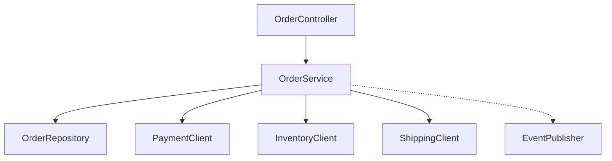

# Domain Blueprint: Order [Level 2]

> **blublu Architecture Level**: Level 2 — Domain Architecture
> Load this file ONLY when working on the Order domain. Do NOT load all sub-blueprints simultaneously.

---

## 1. Domain Identity

- **Name**: Order Service
- **Type**: Backend Microservice (Node.js/TypeScript)
- **Root Path**: `apps/order-service/`
- **Tech Stack**: Node.js v20, TypeScript 5.6, Express 4, Prisma ORM, PostgreSQL
- **Status**: [Verified] — 2026-11-27

---

## 2. Domain Responsibilities

- Accepts and validates incoming order creation requests from api-gateway.
- Orchestrates multi-step checkout: inventory reservation → payment charge → shipping creation.
- Maintains order lifecycle state machine: `pending → confirmed → processing → shipped → delivered | cancelled`.
- Publishes `order.created`, `order.cancelled`, `order.shipped` events to Kafka for downstream consumers.
- Provides order history and status query endpoints for customer-portal.
- Enforces business invariants: orders cannot be cancelled after shipping label is generated.

---

## 3. Module Registry

| Module | Path | Responsibility | Status |
| :--- | :--- | :--- | :--- |
| `OrderController` | `src/controllers/order.controller.ts` | HTTP route handlers for order CRUD and lifecycle | [Verified] |
| `OrderService` | `src/services/order.service.ts` | Core order business logic, state machine, checkout orchestration | [Verified] |
| `OrderRepository` | `src/repositories/order.repository.ts` | Prisma DB access layer for orders and order_items tables | [Verified] |
| `PaymentClient` | `src/clients/payment.client.ts` | Typed HTTP client to billing-service `/charge` endpoint | [Verified] |
| `InventoryClient` | `src/clients/inventory.client.ts` | Typed HTTP client to inventory-service `/reserve` endpoint | [Verified] |
| `ShippingClient` | `src/clients/shipping.client.ts` | HTTP client to external shipping provider REST API | [Inferred] |
| `EventPublisher` | `src/events/publisher.ts` | Kafka producer for order domain events | [Verified] |

---

## 4. Internal Dependency Map

---

## 5. Cross-Domain Dependencies

| Source | Target | Type | Label | Evidence | Confidence |
| :--- | :--- | :--- | :--- | :--- | :--- |
| `PaymentClient` | `billing-service` | `api` | `POST /charge` | `src/clients/payment.client.ts:28` | Confirmed |
| `InventoryClient` | `inventory-service` | `api` | `POST /reserve` | `src/clients/inventory.client.ts:19` | Confirmed |
| `EventPublisher` | `notification-service` | `event` | `order.created` | Architecture pattern (Kafka topic) | Inferred |
| `EventPublisher` | `analytics-service` | `event` | `order.*` | Architecture pattern (Kafka topic) | Inferred |
| `OrderService` | `shared-auth` | `lib` | `validateToken()` | `src/services/order.service.ts:5` | Confirmed |
| `OrderRepository` | `shared-db` | `lib` | `PrismaClient` | `src/repositories/order.repository.ts:3` | Confirmed |

---

## 6. Public API Surface

| Method | Endpoint | Description | Auth Required |
| :--- | :--- | :--- | :--- |
| `POST` | `/api/orders` | Create new order (initiates full checkout) | Yes |
| `GET` | `/api/orders/:id` | Get order by ID | Yes |
| `GET` | `/api/orders?userId=:uid` | List orders for user (paginated) | Yes |
| `PATCH` | `/api/orders/:id/cancel` | Cancel pending or confirmed order | Yes |
| `GET` | `/api/orders/:id/status` | Get lightweight order status | Yes |

> Level 3 detail for `OrderService` module: `.agents/sub-blueprints/order/order-service.md`

---

## 7. Mapping Health

- **Last Updated**: 2026-11-27
- **Agent / Tool**: blublu v2.0.0 (Codsblu)
- **Verification Ratio**: 6/7 modules verified (86%)
- **Health**: Healthy
