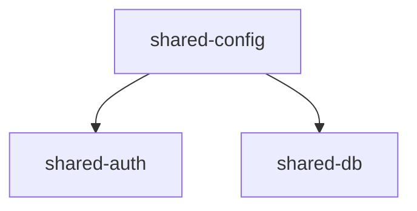

# Domain Blueprint: Shared Libraries [Level 2]

> **blublu Architecture Level**: Level 2 — Domain Architecture
> Load this file ONLY when modifying shared packages. Do NOT load all sub-blueprints simultaneously.

---

## 1. Domain Identity

- **Name**: Shared Libraries
- **Type**: Internal Shared Packages (npm workspaces)
- **Root Path**: `packages/`
- **Tech Stack**: Node.js v20, TypeScript 5.6, Prisma ORM, jsonwebtoken
- **Status**: [Verified] — 2026-11-27

---

## 2. Domain Responsibilities

- Provides centralized configuration loading and environment variable validation (`shared-config`).
- Provides reusable JWT authentication middleware and token utilities (`shared-auth`).
- Provides a singleton PrismaClient wrapper with connection pooling and consistent error handling (`shared-db`).
- Eliminates code duplication across 9 downstream microservices.
- Acts as the internal dependency foundation — changes here cascade to all importing services.

---

## 3. Module Registry

| Module | Path | Responsibility | Status |
| :--- | :--- | :--- | :--- |
| `SharedConfig` | `packages/shared-config/src/index.ts` | Env variable loading, schema validation via Zod, typed config object | [Verified] |
| `SharedAuth` | `packages/shared-auth/src/index.js` | JWT sign/verify, `requireAuth` Express middleware, RBAC helpers | [Verified] |
| `SharedDb` | `packages/shared-db/src/index.ts` | Singleton PrismaClient, connection pooling, Prisma error normalization | [Verified] |

---

## 4. Internal Dependency Map

---

## 5. Cross-Domain Dependencies (Downstream Consumers)

These services IMPORT from shared libraries. Any breaking change here requires updates across all consumers.

| Consumer | Imports From | Type | Evidence | Confidence |
| :--- | :--- | :--- | :--- | :--- |
| `api-gateway` | `shared-auth` | `lib` | `apps/api-gateway/src/index.js:4` | Confirmed |
| `user-service` | `shared-auth`, `shared-db`, `shared-config` | `lib` | `apps/user-service/src/index.ts:1-3` | Confirmed |
| `order-service` | `shared-auth`, `shared-db`, `shared-config` | `lib` | `apps/order-service/src/order.service.js:5` | Confirmed |
| `billing-service` | `shared-auth`, `shared-db` | `lib` | `apps/billing-service/src/index.js:2-3` | Confirmed |
| `inventory-service` | `shared-db`, `shared-config` | `lib` | Inferred from package.json dependencies | Inferred |
| `notification-service` | `shared-config` | `lib` | Inferred from monorepo pattern | Inferred |
| `analytics-service` | `shared-db`, `shared-config` | `lib` | Inferred from monorepo pattern | Inferred |
| `worker-jobs` | `shared-auth`, `shared-config` | `lib` | Inferred from monorepo pattern | Inferred |

> ⚠ **High Fan-In Warning**: `shared-auth` and `shared-db` are imported by 8+ services.
> Any breaking interface change MUST be coordinated across all consumers before merging.

---

## 6. Public Interfaces

### `@nexus/shared-auth` exports:
| Symbol | Signature | Description |
| :--- | :--- | :--- |
| `validateToken` | `(token: string) => JWTPayload` | Verifies and decodes a JWT |
| `requireAuth` | `Express.RequestHandler` | Middleware: rejects unauthenticated requests |
| `createToken` | `(payload: object, expiresIn?: string) => string` | Signs a new JWT |

### `@nexus/shared-db` exports:
| Symbol | Type | Description |
| :--- | :--- | :--- |
| `PrismaClient` | `Class` | Singleton Prisma client with connection pooling |

### `@nexus/shared-config` exports:
| Symbol | Type | Description |
| :--- | :--- | :--- |
| `config` | `AppConfig` | Validated, typed configuration object |
| `KAFKA_TOPICS` | `Record<string, string>` | Centralized Kafka topic name constants |

---

## 7. Mapping Health

- **Last Updated**: 2026-11-27
- **Agent / Tool**: blublu v2.0.0 (Codsblu)
- **Verification Ratio**: 3/3 modules verified (100%)
- **Health**: Healthy
