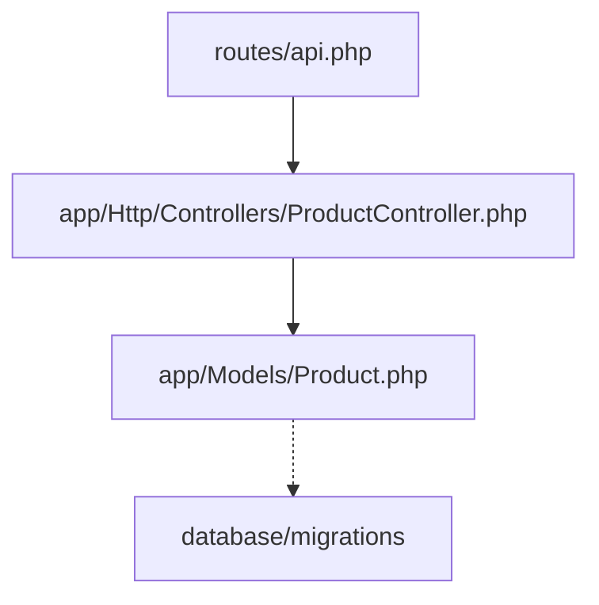

# Codebase Blueprint: Laravel Product API

> Auto-generated and maintained by **blublu**. Source code is the ultimate truth.

---

## 1. Project Overview

- **Name**: laravel-app
- **Core Purpose**: Product catalog API built on PHP 8.2 and Laravel 11 framework.
- **Primary Tech Stack**: PHP 8.2, Laravel 11, SQLite/MySQL.
- **Target Platform**: PHP-FPM / CLI
- **Repository Pattern**: Classic Laravel MVC

---

## 2. Entry Points

| Entry Point | File Path | Type | Purpose / Trigger |
| :--- | :--- | :--- | :--- |
| API Route Manifest | `routes/api.php` | Router | Maps REST route verbs to controller actions |

---

## 3. Directory Structure

```
laravel-app/
├── app/
│   ├── Http/Controllers/     # HTTP controllers handling input validation & responses
│   └── Models/               # Eloquent domain models
├── database/migrations/      # Database table schema migrations
├── routes/                   # Routing definitions (api.php)
└── composer.json             # PHP dependencies and PSR-4 autoload rules
```

---

## 4. Architecture Overview

- **Architectural Style**: Model-View-Controller (MVC) API
- **Layering**:
  - `routes/api.php`: Directs inbound HTTP calls to controllers.
  - `ProductController`: Performs validation and response formatting.
  - `Product`: Domain model representing the catalog entity.

---

## 5. Module Registry

| Module | Path | Responsibility | Dependencies | Status |
| :--- | :--- | :--- | :--- | :--- |
| `ApiRoutes` | `routes/api.php` | Routing configuration for product API resources | `ProductController` | [Verified] |
| `ProductController` | `app/Http/Controllers/ProductController.php` | Request validation, CRUD dispatch, and JSON responses | `Product` | [Verified] |
| `ProductModel` | `app/Models/Product.php` | Product entity schema, attributes, and query methods | None | [Verified] |
| `ProductMigration` | `database/migrations/2026_01_01_000000_create_products_table.php` | Schema definition for `products` table | None | [Verified] |

---

## 6. Dependency Mapping



---

## 7. Main Data Flows

### Flow 1: Create Product Endpoint
1. Client issues `POST /api/v1/products` with name and price.
2. `routes/api.php` matches route to `ProductController::store`.
3. Controller validates input types (`string`, `numeric`).
4. `Product::create()` stores record into products table.
5. JSON response returned with status code 201.

---

## 8. API Mapping

| Method | Route / Endpoint | Module | Auth Required | Description |
| :--- | :--- | :--- | :--- | :--- |
| `GET` | `/api/v1/products` | `ProductController` | No | List all active catalog products |
| `GET` | `/api/v1/products/{id}` | `ProductController` | No | Fetch single product by primary key |
| `POST` | `/api/v1/products` | `ProductController` | No | Create new product listing |

---

## 9. Database Mapping

- **Engine**: SQLite / PostgreSQL
- **ORM**: Eloquent ORM
- **Core Tables**:
  - `products`: ID, name (varchar), price (decimal), timestamps.

---

## 10. External Integrations

*N/A — No external third-party API integrations.*

---

## 11. Project Conventions

- **PSR Standards**: PSR-4 autoloading via Composer, PSR-12 coding standard.
- **Controller Naming**: PascalCase suffixed with `Controller` (e.g. `ProductController`).

---

## 12. Important Business Rules

- **Rule 1**: Product prices must be positive numeric values.
- **Rule 2**: Product names cannot exceed 255 characters.

---

## 13. Known Limitations & Technical Debt

- Migration execution relies on standard Laravel artisan runner.

---

## 14. Recent Architectural Changes

- **2026-11-27**: Bootstrapped Laravel product API fixture.

---

## 15. Mapping Health

- **Last Updated**: 2026-11-27 08:35 UTC
- **Agent / Tool**: blublu v1.0.0
- **Health Status**: Healthy
- **Total Tracked Modules**: 4
- **Verification Ratio**: 100%
