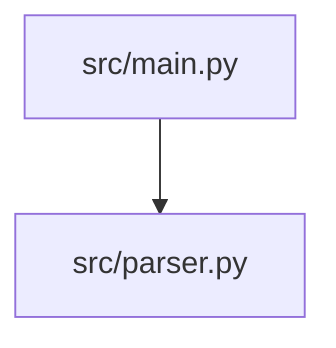

# Codebase Blueprint: Non-Git CLI Application

> Auto-generated and maintained by **blublu**. Source code is the ultimate truth.

---

## 1. Project Overview

- **Name**: non-git-app
- **Core Purpose**: Standalone command-line text parsing tool demonstrating non-git filesystem scanning.
- **Primary Tech Stack**: Python 3.11, standard library.
- **Target Platform**: Python CLI
- **Repository Pattern**: Standalone script package

---

## 2. Entry Points

| Entry Point | File Path | Type | Purpose / Trigger |
| :--- | :--- | :--- | :--- |
| CLI Runner | `src/main.py` | Python Script | CLI argument parser and execution dispatcher |

---

## 3. Directory Structure

```
non-git-app/
├── src/
│   ├── main.py            # CLI entry point
│   └── parser.py          # String tokenization logic
└── pyproject.toml         # Python project configuration
```

---

## 4. Architecture Overview

- **Architectural Style**: Modular CLI
- **Layers**:
  - `src/main.py`: Presentation/CLI input handling.
  - `src/parser.py`: Pure domain parser logic.

---

## 5. Module Registry

| Module | Path | Responsibility | Dependencies | Status |
| :--- | :--- | :--- | :--- | :--- |
| `CliRunner` | `src/main.py` | Parses terminal arguments and delegates to parser | `Parser` | [Verified] |
| `Parser` | `src/parser.py` | Tokenizes and extracts metadata from raw text | None | [Verified] |

---

## 6. Dependency Mapping



---

## 7. Main Data Flows

### Flow 1: Command Line Parsing
1. User runs `python main.py "sample text"`.
2. `src/main.py` receives argument and calls `parse_input()`.
3. `src/parser.py` splits string and counts tokens.
4. Result dictionary printed to standard output.

---

## 8. API Mapping

*N/A — Desktop CLI tool.*

---

## 9. Database Mapping

*N/A — Stateless utility.*

---

## 10. External Integrations

*N/A — No network or external service dependencies.*

---

## 11. Project Conventions

- **Code Style**: PEP 8 standards. Type hints on all function signatures.

---

## 12. Important Business Rules

- **Rule 1**: Empty input produces zero token count.

---

## 13. Known Limitations & Technical Debt

- Operates purely on whitespace delimiters without regex customization.

---

## 14. Recent Architectural Changes

- **2026-11-27**: Created non-git CLI fixture for v1.1.0 filesystem fallback tests.

---

## 15. Mapping Health

- **Last Updated**: 2026-11-27 09:10 UTC
- **Agent / Tool**: blublu v1.1.0
- **Health Status**: Healthy
- **Total Tracked Modules**: 2
- **Verification Ratio**: 100%
