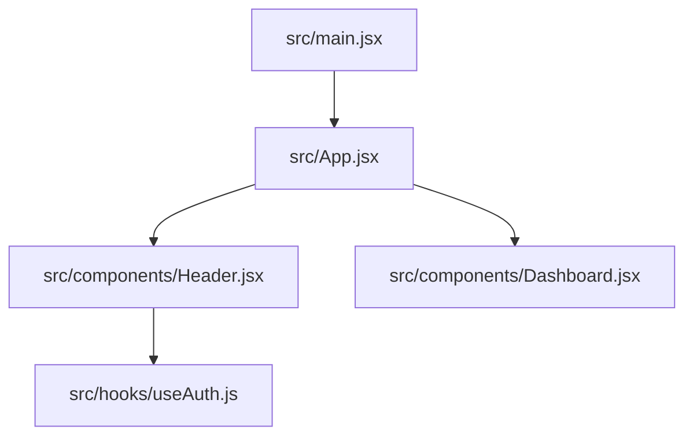

# Codebase Blueprint: React SPA Dashboard

> Auto-generated and maintained by **blublu**. Source code is the ultimate truth.

---

## 1. Project Overview

- **Name**: react-app
- **Core Purpose**: Single Page Application (SPA) dashboard built with React 18 and Vite.
- **Primary Tech Stack**: React 18, Vite 5, Tailwind CSS.
- **Target Platform**: Modern Evergreen Browsers (ESM)
- **Repository Pattern**: Client-side component tree

---

## 2. Entry Points

| Entry Point | File Path | Type | Purpose / Trigger |
| :--- | :--- | :--- | :--- |
| Client DOM Root | `src/main.jsx` | React Root | Mounts React application into `#root` DOM element |

---

## 3. Directory Structure

```
react-app/
├── src/
│   ├── components/        # Reusable UI component views
│   ├── hooks/             # Custom React stateful hooks
│   ├── App.jsx            # Top-level shell and layout view
│   └── main.jsx           # DOM mounting bootstrap
├── vite.config.js         # Vite bundler & plugin configuration
└── package.json           # Frontend dependencies and dev scripts
```

---

## 4. Architecture Overview

- **Architectural Style**: Component-Based Frontend Architecture
- **Separation of Concerns**:
  - `src/components/`: Declarative presentational components.
  - `src/hooks/`: Business logic, session state, and domain abstractions.
  - `src/App.jsx`: Global shell and responsive layout container.

---

## 5. Module Registry

| Module | Path | Responsibility | Dependencies | Status |
| :--- | :--- | :--- | :--- | :--- |
| `MainBootstrap` | `src/main.jsx` | React DOM initialization and StrictMode setup | `App` | [Verified] |
| `AppLayout` | `src/App.jsx` | Top-level grid layout and view composition | `Header`, `Dashboard` | [Verified] |
| `HeaderComponent` | `src/components/Header.jsx` | Top navigation bar and user authentication controls | `useAuth` | [Verified] |
| `DashboardComponent`| `src/components/Dashboard.jsx` | Architectural metrics summary cards | None | [Verified] |
| `AuthHook` | `src/hooks/useAuth.js` | Session state tracking and logout action | None | [Verified] |

---

## 6. Dependency Mapping



---

## 7. Main Data Flows

### Flow 1: User Session & Logout Interaction
1. `HeaderComponent` subscribes to state returned by `useAuth()`.
2. When user clicks "Logout", `useAuth.logout()` resets user state to `null`.
3. Header component triggers re-render, displaying "Guest" instead of username.

---

## 8. API Mapping

*N/A — Client-side static SPA application; consumes external APIs via fetch/hooks.*

---

## 9. Database Mapping

*N/A — Client-side state managed in React hooks; no direct database connection.*

---

## 10. External Integrations

*N/A — Standalone client demo.*

---

## 11. Project Conventions

- **Component Naming**: `PascalCase.jsx` for components, `useCamelCase.js` for custom hooks.
- **Styling**: Tailwind CSS utility classes colocated in JSX `className`.

---

## 12. Important Business Rules

- **Rule 1**: Only authenticated users see the logout action.
- **Rule 2**: SPA renders responsive grid on mobile and multi-column on desktop.

---

## 13. Known Limitations & Technical Debt

- Mock authentication hook does not yet persist sessions to `localStorage`.

---

## 14. Recent Architectural Changes

- **2026-11-27**: Created React 18 + Vite fixture for blublu test suite.

---

## 15. Mapping Health

- **Last Updated**: 2026-11-27 08:35 UTC
- **Agent / Tool**: blublu v1.0.0
- **Health Status**: Healthy
- **Total Tracked Modules**: 5
- **Verification Ratio**: 100%
