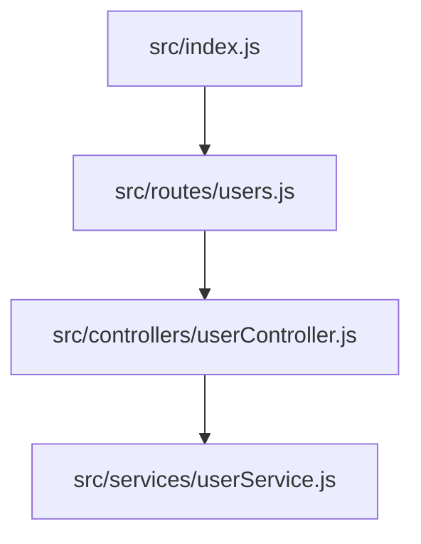

# Codebase Blueprint: Simple Node Express API

> Auto-generated and maintained by **blublu**. Source code is the ultimate truth.

---

## 1. Project Overview

- **Name**: simple-node-app
- **Core Purpose**: Minimalist Express.js REST API serving user management endpoints.
- **Primary Tech Stack**: Node.js, Express 4.19, CORS, Dotenv.
- **Target Platform**: Node.js v18+ LTS
- **Repository Pattern**: Modular MVC monolith

---

## 2. Entry Points

| Entry Point | File Path | Type | Purpose / Trigger |
| :--- | :--- | :--- | :--- |
| HTTP Server | `src/index.js` | Express Server | Bootstraps Express HTTP server on PORT |

---

## 3. Directory Structure

```
simple-node-app/
├── src/
│   ├── controllers/       # HTTP request handlers & response formatting
│   ├── routes/            # Express router route definitions
│   ├── services/          # In-memory user business logic
│   └── index.js           # Server bootstrap & middleware
└── package.json           # Dependencies and scripts
```

---

## 4. Architecture Overview

- **Architectural Style**: Layered MVC (Routes -> Controllers -> Services)
- **Separation of Concerns**:
  - `routes/`: Declares HTTP methods and endpoints.
  - `controllers/`: Validates request inputs and serializes HTTP responses.
  - `services/`: Encapsulates business logic and in-memory persistence.

---

## 5. Module Registry

| Module | Path | Responsibility | Dependencies | Status |
| :--- | :--- | :--- | :--- | :--- |
| `ServerBootstrap` | `src/index.js` | Express middleware configuration, CORS, server listener | `Express`, `UserRoutes` | [Verified] |
| `UserRoutes` | `src/routes/users.js` | REST endpoint routing for /api/users | `UserController` | [Verified] |
| `UserController` | `src/controllers/userController.js` | HTTP parameter validation and response serialization | `UserService` | [Verified] |
| `UserService` | `src/services/userService.js` | User storage, retrieval, and registration logic | None | [Verified] |

---

## 6. Dependency Mapping



---

## 7. Main Data Flows

### Flow 1: Create User Flow
1. Client issues `POST /api/users` with `{ name, email }`.
2. `src/routes/users.js` routes request to `userController.createUser`.
3. `userController.js` checks presence of `name` and `email`.
4. `userService.js` creates and appends user object to collection.
5. Controller returns HTTP 201 with newly created user payload.

---

## 8. API Mapping

| Method | Route / Endpoint | Module | Auth Required | Description |
| :--- | :--- | :--- | :--- | :--- |
| `GET` | `/health` | `ServerBootstrap` | No | Health check ping |
| `GET` | `/api/users` | `UserController` | No | Retrieves list of all active users |
| `GET` | `/api/users/:id` | `UserController` | No | Retrieves user profile by ID |
| `POST` | `/api/users` | `UserController` | No | Registers new user |

---

## 9. Database Mapping

*N/A — In-memory persistence used for test fixture.*

---

## 10. External Integrations

*N/A — No external SaaS or cloud dependencies.*

---

## 11. Project Conventions

- **File Naming**: `camelCase.js` for controllers and services, plural lowercase for routes (`users.js`).
- **Response Format**: Always return `{ success: boolean, data?: any, message?: string }`.

---

## 12. Important Business Rules

- **Rule 1**: Email addresses and names are mandatory fields for user registration.
- **Rule 2**: IDs are sequentially generated strings.

---

## 13. Known Limitations & Technical Debt

- Data resets upon server restart because persistence is purely in-memory.

---

## 14. Recent Architectural Changes

- **2026-11-27**: Initialized simple-node-app test fixture and mapped architecture.

---

## 15. Mapping Health

- **Last Updated**: 2026-11-27 08:35 UTC
- **Agent / Tool**: blublu v1.0.0
- **Health Status**: Healthy
- **Total Tracked Modules**: 4
- **Verification Ratio**: 100%
