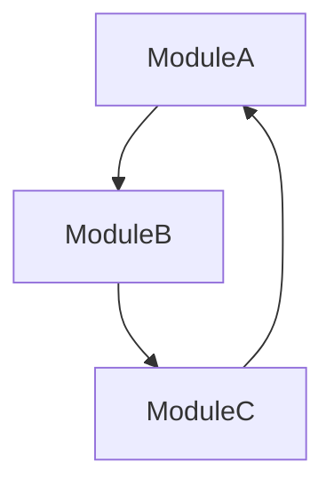

# Test Scenarios: Cross-Service Dependency Analysis (v2.0.0)

This document defines test scenarios for dependency discovery, Confidence labeling, and circular dependency detection in blublu v2.0.0.

**Commands**:
- `python scripts/blublu.py dependencies --path <dir> [--module <name>] [--format table|json]`
- Blueprint dependency tables follow format: `| Source | Target | Type | Label | Evidence | Confidence |`

---

## Scenario 1: Confirmed Dependency — Direct Import Evidence

**Fixture**: `tests/fixtures/enterprise-monorepo/apps/order-service/src/order.service.js`

The file contains:
```js
const { validateToken } = require('@nexus/shared-auth');
const { KAFKA_TOPICS } = require('@nexus/shared-config');
```

**Expected Blueprint Entry**:
```markdown
| Source | Target | Type | Label | Evidence | Confidence |
| `OrderService` | `shared-auth` | `lib` | `validateToken()` | `src/order.service.js:1` | Confirmed |
| `OrderService` | `shared-config` | `lib` | `KAFKA_TOPICS` | `src/order.service.js:2` | Confirmed |
```

**Pass Criteria**:
- Dependency entry exists in `order.md` with `Confidence: Confirmed`.
- Evidence field contains the file path and approximate line number.
- Dependency is NOT created without reading the source file.

---

## Scenario 2: Inferred Dependency — Architecture Pattern

**Scenario**: The notification-service is known (from architecture pattern) to consume `order.created` events from Kafka, but no source file inspection has been done yet.

**Expected Blueprint Entry**:
```markdown
| `EventPublisher` | `notification-service` | `event` | `order.created` | Architecture pattern (Kafka topic) | Inferred |
```

**Verification**:
```bash
python scripts/blublu.py dependencies \
  --path tests/fixtures/enterprise-monorepo \
  --module EventPublisher \
  --format table
```

**Expected Table Output**:
```
| Source | Target | Type | Label | Confidence |
| :--- | :--- | :--- | :--- | :--- |
| `EventPublisher` | `notification-service` | `event` | order.created | Inferred |
| `EventPublisher` | `analytics-service` | `event` | order.* | Inferred |
```

**Pass Criteria**:
- Inferred entries present in output.
- No `Confirmed` label on entries without source code evidence.
- Command exits with code 0.

---

## Scenario 3: Circular Dependency Detection

**Setup**: Create a test fixture with a circular dependency chain:
- `ModuleA` imports from `ModuleB`
- `ModuleB` imports from `ModuleC`
- `ModuleC` imports from `ModuleA`

Encode this in a Mermaid graph in a test blueprint:


**Expected Behavior**:
1. `blublu dependencies` detects the cycle.
2. Each node in the cycle is flagged.
3. Cycle path is printed: `ModuleA → ModuleB → ModuleC → ModuleA`.

**Command**:
```bash
python scripts/blublu.py dependencies \
  --path tests/fixtures/simple-node-app \
  --format json
```

**Expected JSON Metadata** (from graph_export.py):
```json
{
  "metadata": {
    "circular_dependencies": ["ModuleA → ModuleB → ModuleC → ModuleA"]
  }
}
```

**Expected CLI Warning**:
```
[!!] CIRCULAR DEPENDENCY DETECTED: ModuleA → ModuleB → ModuleC → ModuleA
     Recommendation: Refactor to break the cycle. See Section 14 for tracking.
```

**Pass Criteria**:
- Circular dependency detected and reported.
- Cycle path includes all nodes in the cycle.
- Blueprint is NOT automatically modified.
- `[CIRCULAR DEPENDENCY - REVIEW REQUIRED]` flagging noted in output.

---

## Scenario 4: Filtered Dependency Map — Single Module

**Command**:
```bash
python scripts/blublu.py dependencies \
  --path tests/fixtures/enterprise-monorepo \
  --module OrderService \
  --format table
```

**Expected Markdown Table Output**:
```
| Source | Target | Type | Label | Confidence |
| :--- | :--- | :--- | :--- | :--- |
| `OrderController` | `OrderService` | `import` | OrderController->OrderService | Inferred |
| `OrderService` | `OrderRepository` | `import` | OrderService->OrderRepository | Inferred |
| `OrderService` | `PaymentClient` | `import` | OrderService->PaymentClient | Inferred |
| `OrderService` | `InventoryClient` | `import` | OrderService->InventoryClient | Inferred |
| `OrderService` | `shared-auth` | `lib` | validateToken() | Confirmed |
| `OrderService` | `shared-config` | `lib` | KAFKA_TOPICS | Confirmed |
```

**Pass Criteria**:
- Output is a valid Markdown table.
- Only edges where `source` or `target` contains "OrderService" are shown.
- Both `Confirmed` and `Inferred` edges present.
- Exit code: 0.

---

## Scenario 5: Full Project Dependency Map — JSON Format

**Command**:
```bash
python scripts/blublu.py dependencies \
  --path tests/fixtures/enterprise-monorepo \
  --format json
```

**Expected JSON Structure**:
```json
[
  {
    "source": "APIGateway",
    "target": "UserService",
    "type": "import",
    "label": "APIGateway->UserService",
    "confidence": "Inferred",
    "source_file": "codebase-map.md"
  },
  ...
]
```

**Pass Criteria**:
- Output is valid JSON array.
- Each edge has: `source`, `target`, `type`, `label`, `confidence`, `source_file`.
- Edge count ≥ 5 (from the Mermaid graph in the enterprise fixture).
- Exit code: 0.

---

## Scenario 6: Evidence Prohibition — Similar Names

**Input**: Agent is analyzing a codebase where `UserModule` and `UserService` both exist.
No import between them has been found in source code.

**Expected Agent Behavior**:
- Agent does NOT create a dependency entry between `UserModule` and `UserService`.
- Agent states: "No evidence of a direct dependency found in source code. Similar names do not imply a dependency."
- If asked to record this, agent responds: "Please provide a source file path and line number as evidence before recording this as a `Confirmed` dependency."

**Blueprint State After**:
- No entry like `| UserModule | UserService | ... |` in the dependency table.

**Pass Criteria**:
- No phantom dependency created from naming similarity alone.
- Agent requests evidence before recording as Confirmed.
- Blueprint remains clean and evidence-only.

---

## Scenario 7: Confidence Upgrade Protocol

**Setup**: A dependency is currently recorded as `Unverified`:
```markdown
| `LegacyReporter` | `UserService` | `db-shared` | `users table` | `docs/legacy-arch.md` | Unverified |
```

**Expected Behavior When Upgrading**:
1. Agent is asked to verify this dependency.
2. Agent opens `LegacyReporter` source files and finds: `SELECT * FROM users WHERE id = $1`.
3. Agent upgrades the entry:
```markdown
| `LegacyReporter` | `UserService` | `db-shared` | `users table` | `src/reporter/db.js:42` | Confirmed |
```

**Pass Criteria**:
- `Unverified` → `Confirmed` upgrade only happens after direct source inspection.
- Evidence field updated from `docs/legacy-arch.md` to `src/reporter/db.js:42`.
- Agent does NOT upgrade to Confirmed without reading the actual source.
