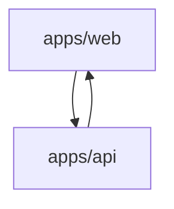

# Test Scenarios: Architecture Graph Export (v2.0.0)

This document defines test scenarios for `scripts/graph_export.py` — the machine-readable architecture graph exporter introduced in blublu v2.0.0.

**Script**: `python scripts/graph_export.py`
**Key Principle**: graph_export.py is READ-ONLY. It never creates or modifies any `.agents/*.md` blueprint files.

---

## Scenario 1: Basic JSON Export — Simple Node App

**Command**:
```bash
python scripts/graph_export.py \
  --path tests/fixtures/simple-node-app \
  --format json
```

**Expected JSON Structure**:
```json
{
  "version": "2.0.0",
  "generated_at": "2026-11-27T...",
  "project": {
    "name": "simple-node-app",
    "root_path": "..."
  },
  "nodes": [
    {
      "id": "UserController",
      "name": "UserController",
      "domain": "root",
      "path": "src/controllers/userController.js",
      "type": "service",
      "status": "Verified"
    }
  ],
  "edges": [ ... ],
  "metadata": {
    "node_count": 3,
    "edge_count": 2,
    "circular_dependencies": [],
    "unverified_edges": 0
  }
}
```

**Pass Criteria**:
- Output is valid JSON (parseable with `json.loads()`).
- `version` field is exactly `"2.0.0"`.
- `nodes` array has ≥ 1 entry.
- Each node has: `id`, `name`, `domain`, `path`, `type`, `status`.
- `metadata.node_count` matches `len(nodes)`.
- Exit code: 0.

---

## Scenario 2: YAML Export — Distributed App

**Command**:
```bash
python scripts/graph_export.py \
  --path tests/fixtures/distributed-app \
  --format yaml
```

**Expected YAML Structure**:
```yaml
---
version: "2.0.0"
generated_at: "2026-11-27T..."
project:
  name: distributed-app
  root_path: "..."
nodes:
  - id: ...
    name: ...
    domain: root
    path: ...
    type: service
    status: Verified
edges:
  - source: ...
    target: ...
    type: import
    label: ...
    confidence: Inferred
metadata:
  node_count: 2
  edge_count: 1
  circular_dependencies: []
  unverified_edges: 0
```

**Pass Criteria**:
- Output starts with `---` (valid YAML document marker).
- YAML is well-formed (no syntax errors).
- `nodes` section is present and non-empty.
- Exit code: 0.

---

## Scenario 3: Both Formats — Output to Files

**Command**:
```bash
python scripts/graph_export.py \
  --path tests/fixtures/distributed-app \
  --format both \
  --output /tmp/arch-graph
```

**Expected**:
- File `/tmp/arch-graph.json` created with valid JSON.
- File `/tmp/arch-graph.yaml` created with valid YAML.
- Both files contain identical architectural data (different formats only).
- Stdout: Confirmation messages for both files.

**Expected Stdout**:
```
✔ JSON graph written to: /tmp/arch-graph.json
✔ YAML graph written to: /tmp/arch-graph.yaml
```

**Pass Criteria**:
- Both output files exist and are non-empty.
- JSON file: `json.loads(open('arch-graph.json').read())` succeeds.
- YAML file starts with `---`.
- Exit code: 0.

---

## Scenario 4: Sub-Blueprint Inclusion — Enterprise Monorepo

**Command**:
```bash
python scripts/graph_export.py \
  --path tests/fixtures/enterprise-monorepo \
  --format json \
  --include-sub-blueprints
```

**Expected Behavior**:
- Nodes from root Level 1 blueprint included (13 domain entries).
- Additional nodes from sub-blueprints added (OrderController, OrderService, OrderRepository, PaymentClient, etc. from order.md).
- Additional nodes from shared-libs.md (SharedConfig, SharedAuth, SharedDb).
- Cross-domain edges from dependency tables in sub-blueprints included.

**Expected Node Count**: ≥ 20 (13 root + 7 from order.md + 3 from shared-libs.md).

**Pass Criteria**:
- `metadata.node_count` ≥ 20 when `--include-sub-blueprints` is passed.
- `metadata.node_count` ≤ 13 when `--include-sub-blueprints` is omitted (root-only).
- Cross-domain edges have `confidence: "Confirmed"` for edges backed by dependency tables.
- Exit code: 0.

---

## Scenario 5: Graph Validation — Valid File

**Setup**: First generate a graph:
```bash
python scripts/graph_export.py \
  --path tests/fixtures/simple-node-app \
  --format json \
  --output /tmp/test-graph
```

**Validation Command**:
```bash
python scripts/graph_export.py --validate-graph /tmp/test-graph.json
```

**Expected Output**:
```
✔ Graph is VALID: /tmp/test-graph.json
```

**Pass Criteria**:
- Exit code: 0.
- No `[ERR]` lines in output.
- Optionally, `[WARN]` lines may appear for missing optional fields.

---

## Scenario 6: Graph Validation — Invalid File

**Setup**: Create a malformed graph JSON:
```json
{
  "version": "1.0.0",
  "nodes": [
    {"id": "NodeA", "name": "NodeA"}
  ],
  "edges": [
    {"source": "NodeA", "target": "NonExistentNode", "type": "api", "confidence": "Confirmed"}
  ]
}
```
Save as `/tmp/invalid-graph.json`.

**Command**:
```bash
python scripts/graph_export.py --validate-graph /tmp/invalid-graph.json
```

**Expected Output**:
```
✖ Graph is INVALID: /tmp/invalid-graph.json
  [ERR]  Node[0] missing fields: path, status, type
  [ERR]  Edge[0] target 'NonExistentNode' references unknown node ID
  [WARN] Version is '1.0.0', expected '2.0.0'
```

**Pass Criteria**:
- Exit code: 1.
- Specific error messages identify exact problems.
- Missing required fields are enumerated.
- Unknown node references in edges are flagged.

---

## Scenario 7: Circular Dependency in Graph Output

**Setup**: Modify `tests/fixtures/distributed-app/.agents/codebase-map.md` Section 6 Mermaid to add a cycle:


**Command**:
```bash
python scripts/graph_export.py \
  --path tests/fixtures/distributed-app \
  --format json
```

**Expected JSON**:
```json
{
  "metadata": {
    "circular_dependencies": ["WebApp → APIServer → WebApp"],
    ...
  }
}
```

**Expected Stderr Warning**:
```
[INFO] Nodes: 2, Edges: 2, Unverified Edges: 0 ⚠ 1 circular dep(s) detected!
  [CIRCULAR] WebApp → APIServer → WebApp
```

**Pass Criteria**:
- `metadata.circular_dependencies` is a non-empty array.
- Cycle path string contains all nodes in the cycle.
- Exit code: 0 (circular deps are reported, not fatal to export).
- Blueprint file is NOT modified.

---

## Scenario 8: Derived-Output Guarantee (Read-Only Verification)

**Purpose**: Confirm graph_export.py NEVER creates or modifies blueprint files.

**Command**:
```bash
# Record directory state before
python -c "
import os, hashlib
files = {}
for root, dirs, fnames in os.walk('tests/fixtures/simple-node-app/.agents'):
    for f in fnames:
        p = os.path.join(root, f)
        files[p] = hashlib.sha256(open(p,'rb').read()).hexdigest()
print(files)
" > /tmp/before-state.txt

# Run graph export
python scripts/graph_export.py --path tests/fixtures/simple-node-app --format both --output /tmp/test-graph

# Record directory state after
python -c "
import os, hashlib
files = {}
for root, dirs, fnames in os.walk('tests/fixtures/simple-node-app/.agents'):
    for f in fnames:
        p = os.path.join(root, f)
        files[p] = hashlib.sha256(open(p,'rb').read()).hexdigest()
print(files)
" > /tmp/after-state.txt

# Compare
diff /tmp/before-state.txt /tmp/after-state.txt
```

**Expected Result**: `diff` output is empty (no differences).

**Pass Criteria**:
- All `.agents/*.md` files have identical hashes before and after graph export.
- No new `.md` files created in `.agents/`.
- Output files (`/tmp/test-graph.json`, `/tmp/test-graph.yaml`) are created OUTSIDE the fixture directory.
- Exit code: 0.
